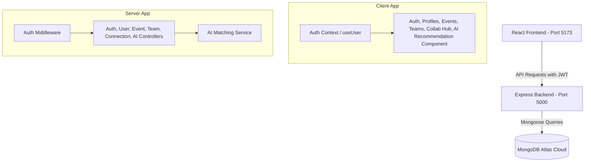

# TechScape (Full-Stack Event & Developer Hub)

TechScape is a premium, full-stack web application designed for developer communities to discover tech events (hackathons, coding contests, workshops, meetups), build developer profiles, form collaborative teams, and coordinate projects together. 

## Features

- 🔐 **Custom Authentication**: Secure, JWT-based sign-up and login with password hashing (`bcryptjs`).
- 👤 **Developer Profiles**: Customize your technical roles, highlight core skills, and list your top projects.
- ⚡ **Event Aggregator**: Search, filter, and discover upcoming tech events, bookmark events to your personal watchlist, and host your own community events.
- 👥 **Team Formation & Hubs**: Create custom teams for events, define required skills, list open roles, and invite accepted connections.
- 🤝 **Connection Request System**: Connect with candidate developers matching specific roles (Frontend, Backend, Design, AI/ML) and coordinate invites.
- 🚀 **Team Collaboration Dashboard**: Real-time mock workspace chat rooms, a drag-and-drop task Kanban board, and shared team notes.
- 🧠 **AI Teammate Recommendation**: Match team requirements (skills, roles, complexity) against candidate profiles using a smart scoring algorithm (Skill Match, Role Match, Project Relevance, Experience Match) and generate natural language explanations of match compatibility.

---

## Technical Stack

- **Frontend**: React.js, Vite, TailwindCSS (for sleek responsive layouts), Framer Motion (for dynamic premium micro-animations), Axios, React Router v7, Radix UI primitives.
- **Backend**: Node.js, Express.js (REST APIs).
- **Database**: MongoDB (Mongoose Object Modeling).
- **Authentication**: Custom JWT (JSON Web Tokens).

---

## System Architecture



---

## Project Folder Structure

```
TechScape_app/
├── client/                 # Frontend React + Vite app
│   ├── src/
│   │   ├── components/     # UI primitives & navigation components
│   │   ├── contexts/       # Authentication context provider
│   │   ├── layouts/        # Layout shells (Main & Dashboard layouts)
│   │   ├── lib/            # Axios API client services
│   │   ├── pages/          # Auth, Event, Team, & Profile pages
│   │   └── main.jsx        # App mounting and provider bootstrapping
│   └── package.json
│
├── server/                 # Express backend server
│   ├── config/             # Database connection setup
│   ├── controllers/        # Request controllers (business logic)
│   ├── middleware/         # Auth verification middleware
│   ├── models/             # Mongoose MongoDB schemas
│   ├── routes/             # Router mappings
│   ├── server.js           # Server startup script
│   └── package.json
│
└── .env                    # Root environment variables configuration
```

---

## Installation & Setup

### Prerequisites

- Node.js installed (v20+ recommended)
- MongoDB installed locally OR a MongoDB Atlas database URL

### 1. Backend Setup

1. Open a terminal in the `server` directory:
   ```bash
   cd server
   ```

2. Install dependencies:
   ```bash
   npm install
   ```

3. Configure environment variables. Create a `.env` file in the `server` directory:
   ```env
   PORT=5000
   MONGO_URI=mongodb+srv://<your_username>:<your_password>@cluster.mongodb.net/techscape?retryWrites=true&w=majority
   JWT_SECRET=your_jwt_secret_key_here
   ```

4. Run the server in development mode (using nodemon):
   ```bash
   npm run dev
   ```
   *The backend server will launch at `http://localhost:5000`.*

### 2. Frontend Setup

1. Open a new terminal in the `client` directory:
   ```bash
   cd client
   ```

2. Install dependencies:
   ```bash
   npm install
   ```

3. Run the client development server:
   ```bash
   npm run dev
   ```
   *The client application will run at `http://localhost:5173`.*

---

## API Documentation

### Authentication Routes (`/api/auth`)
- `POST /register`: Registers a new user. Expects `{ email, password, full_name, username }`.
- `POST /login`: Log in existing user. Expects `{ email, password }`.
- `GET /me`: Returns details of current authenticated user.

### Profiles Routes (`/api/profiles`)
- `GET /:identifier`: Fetch profile by user ID or username.
- `PUT /:id`: Update profile info. Expects profile payload.
- `GET /username/check`: Check username availability.
- `GET /role/:role`: Retrieve user candidates matching a role.

### Events Routes (`/api/events`)
- `GET /`: Get all events.
- `GET /:id`: Fetch event by ID.
- `POST /`: Create new event.
- `GET /watchlist/user/:uid`: Fetch user watchlist.
- `POST /:id/watchlist`: Add event to watchlist.
- `DELETE /:id/watchlist`: Remove event from watchlist.

### Teams Routes (`/api/teams`)
- `GET /`: Retrieve all teams.
- `GET /:id`: Fetch team details.
- `POST /`: Create a new team.
- `POST /:id/members`: Add member to team.
- `GET /user/:uid`: Fetch active user teams.

### Connection Requests Routes (`/api/connections`)
- `POST /`: Send connection request. Expects `{ from_user, to_user }`.
- `GET /status`: Check status of connection query.
- `GET /pending/:uid`: Get pending connection requests.
- `PUT /:id`: Accept or reject request.
- `GET /accepted/:uid`: Fetch accepted connection IDs.

### AI Teammate Recommendation Routes (`/api/ai`)
- `GET /recommend-teammates/:teamId`: Retrieve ranked list of recommended developers with match percentages and compatibility explanation text.
